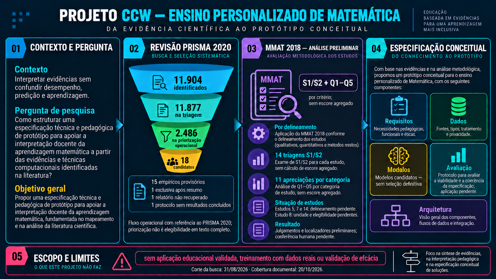
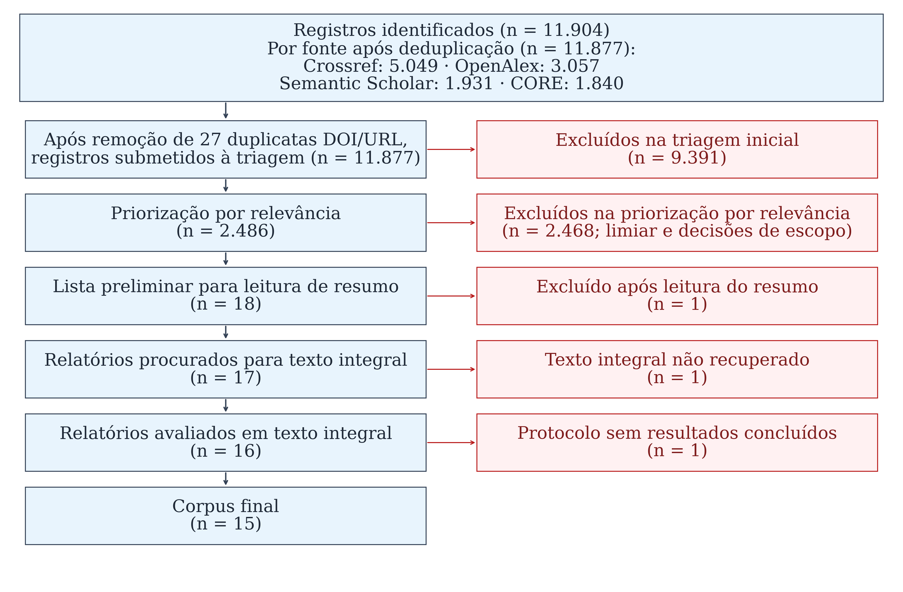

# Ensino Personalizado de Matemática: Oportunidades e Técnicas Computacionais

**Trabalho de Conclusão de Curso - Ciência da Computação - IFC Videira**

<!-- ccw-sync:start snapshot -->
Corte da busca: 31/08/2026; adjudicação inicial: 03/09/2026; reconciliação do escopo: 20/10/2026; cobertura documental: 20/10/2026.

O snapshot registra 11.904 registros identificados, 27 remoções determinísticas por DOI/URL e 11.877 registros na triagem. Foram 2.486 submetidos à priorização operacional; 2.468 não avançaram dessa etapa. A priorização encaminhou 18 candidatos, não 18 inclusões finais: 15 estudos empíricos mantidos provisoriamente, 1 exclusão após resumo, 1 relatório não recuperado no fluxo histórico e 1 protocolo excluído após texto completo. No MMAT preliminar, há 15 triagens S1/S2 e 15 apreciações por categoria; não há escore agregado nem aprovação científica final.
<!-- ccw-sync:end snapshot -->

O estado público, os limites interpretativos e as decisões metodológicas ainda
pendentes estão resumidos em [`docs/tcc/ESTADO-ATUAL-TCC.md`](docs/tcc/ESTADO-ATUAL-TCC.md).

## Sobre o Projeto

Este repositório documenta uma revisão crítica da literatura e uma especificação
técnica e pedagógica de protótipo para apoiar a interpretação docente da
aprendizagem matemática. Esse apoio não significa inferir aprendizagem diretamente
de notas ou de probabilidades preditivas. A entrega é documental: a especificação
e seu protocolo de avaliação foram propostos, mas a avaliação da especificação e
a validação educacional do protótipo não foram realizadas nesta versão.



> O texto do [TCC](results/tcc/main.tex) é a fonte de verdade do relato científico;
> os artefatos versionados sustentam suas contagens e sua rastreabilidade. A imagem
> é uma síntese, não substitui o manuscrito e não certifica revisão científica
> concluída. Em 29/10/2026, há 16 PDFs locais para 18 candidatos; faltam os
> registros 3 e 6923, sem mudança retroativa do fluxo histórico.



### Tema

Aplicações de técnicas computacionais no ensino de matemática e elaboração de uma especificação conceitual de apoio à interpretação docente.

## Orientação

- **Orientador:** Prof. Dr. Rafael Zanin (IFC)
- **Coorientador:** Prof. Dr. Manassés Ribeiro (IFC)

## Objetivos

Os objetivos abaixo são derivados de
[`introducao.tex`](results/tcc/conteudo/introducao.tex). A revisão, o relato PRISMA
2020, o MMAT 2018 e os scripts são meios metodológicos para atendê-los, não objetivos
adicionais nem certificações automáticas de validade científica.

<!-- ccw-sync:start goals -->
### Objetivo geral

Propor uma especificação técnica e pedagógica de protótipo para apoiar a interpretação docente da aprendizagem matemática, fundamentada no mapeamento e na análise da literatura científica.

### Objetivos específicos

**OE1:** categorizar as abordagens e técnicas computacionais e as finalidades pedagógicas descritas na literatura mapeada.

**OE2:** identificar limitações e lacunas técnicas, pedagógicas, metodológicas e éticas no material examinado.

**OE3:** formular a especificação técnica e pedagógica do protótipo, incluindo requisitos, critérios para seleção de fontes de dados e modelos e uma arquitetura de referência.

**OE4:** propor um protocolo para avaliar a viabilidade e a coerência da especificação conceitual, considerando sua fundamentação, a consistência dos requisitos e as condições técnicas e pedagógicas de uma eventual execução.
<!-- ccw-sync:end goals -->

## Estrutura do Repositório

```bash
├── .github/            # Automação e validação do repositório
├── docs/               # Governança, regulamento e notas de auditoria
├── research/           # Código e evidências da revisão da literatura
│   ├── src/            # Coleta, processamento, análise e verificadores
│   ├── tests/          # Testes de software e contratos documentais
│   ├── data/           # Protocolo, escopo, fontes e MMAT versionados
│   ├── exports/        # Snapshot, relatórios e visualizações versionados
│   └── private/        # Acervo e auditorias locais; ignorados pelo Git
├── prototype/          # Código técnico com testes sintéticos, sem ensaio educacional
├── results/            # PTC histórico e fontes, PDF e export paralelo do TCC
├── presentation/       # Fonte canônica da apresentação Slidev
├── scripts/            # Compilação, publicação e sincronização documental
└── README.md           # Visão geral derivada do TCC e dos artefatos
```

## Apresentação

A fonte está em [`presentation/slides.md`](presentation/slides.md). O workflow
compila a versão hospedável e a publica em [Abrir apresentação Slidev](https://thalesfb.github.io/ccw/presentation/), sem exigir comandos locais.

## Uso do Módulo Research

O módulo `research/` automatiza tarefas de coleta, deduplicação, filtragem,
priorização e exportação. PRISMA 2020 orienta o relato; os scripts não realizam
sozinhos a revisão crítica nem validam elegibilidade e MMAT. Execute os comandos
abaixo a partir da **raiz deste checkout**, não de `research/`.

### Configuração Inicial

#### Instalar dependências

```bash
python -m venv .venv
source .venv/bin/activate  # PowerShell: .\.venv\Scripts\Activate.ps1
python -m pip install -r research/requirements.txt
```

#### Inicializar banco de dados:

```bash
python -m research.src.cli init-db
```

### Comandos Disponíveis

#### 1. Nova execução de busca

Consulta APIs e modifica o banco operacional local. Não é necessário executar
este comando para conferir o snapshot versionado e ele não reproduz, por si só,
as decisões documentais e humanas da revisão:

```bash
python -m research.src.cli run-pipeline --min-score 4.0
```

Para verificar o material versionado, sem nova coleta ou leitura do SQLite:

```bash
python -m research.src.validation.versioned_snapshot
python -m research.src.processing.adjudicated_snapshot --check
python scripts/sync_project_docs.py --check
```

#### 2. Estatísticas

Visualiza métricas do banco de dados:

```bash
python -m research.src.cli stats
```

#### 3. Exportação Padrão

Exporta relatórios do banco local. Uma exportação de outra coleta não deve
sobrescrever o snapshot de referência sem reconciliação explícita:

```bash
python -m research.src.cli export
```

**Saídas**:

- `research/exports/analysis/papers.csv` - Dados tabulares
- `research/exports/reports/reproducibility_manifest.json` - Manifesto versionado do snapshot, decisões de auditoria e hashes
- `research/exports/reports/summary_report.html` - Relatório visual
- `research/exports/visualizations/*.png` - Visualizações derivadas

#### 4. Exportação BibTeX

Gera referências bibliográficas formatadas para LaTeX:

```bash
# Apenas papers incluídos
python -m research.src.cli export-bibtex --included-only

# Todos os papers do banco
python -m research.src.cli export-bibtex
```

**Saídas**:

- `research/exports/references/included_papers.bib` - Registros bibliográficos derivados do snapshot vigente (18 na lista preliminar; consultar a disposição atual de cada registro no manifesto de escopo)
- `research/exports/references/high_relevance.bib` - Registros com score de relevância ≥ 7,0 quando gerado pelo CLI; não é um artefato versionado do snapshot vigente
- `research/exports/references/technique_*.bib` - Por técnica computacional

No snapshot versionado, `included_papers.bib` preserva os 18 candidatos da lista
preliminar; seu nome não significa 18 inclusões empíricas finais. Uma nova
exportação consulta o banco local e pode produzir outro conjunto. O protocolo
6921 é mantido para rastreabilidade, mas não sustenta
afirmações empíricas. As referências de fundamentação pedagógica, avaliação,
metodologia e técnica são mantidas separadamente na bibliografia completa do
TCC e não alteram a contagem de estudos incluídos.

**Uso em LaTeX**:

```latex
\bibliography{included_papers}
% O estilo autor-data do TCC é configurado em config_inicial.tex.
```

Esse exemplo usa apenas o export bibliográfico. No TCC, preserve a bibliografia
completa declarada em `main.tex`, incluindo as fontes teóricas e metodológicas;
não a substitua pelo subconjunto de candidatos do pipeline.

### Testes

```bash
# Testes locais, sem a consulta de integração à API
python -m pytest research/tests -m "not integration" -q

# Testes específicos
python -m pytest research/tests/test_documentation_sync.py -q
python -m pytest research/tests/test_defense_consistency.py -q
```

---

## 🛠️ Scripts do Repositório

### Scripts Ativos (Uso Recomendado)

- **`research/src/cli.py`**: Interface CLI oficial para todas operações do pipeline
  - Uso: `python -m research.src.cli [comando] [opções]`
  - Comandos principais: `init-db`, `run-pipeline`, `stats`, `export`, `export-bibtex`, `generate-manifest`, `normalize-prisma`, `validate-exports`, `check-exports`
  - `audit` é legado e depende de um módulo ausente; sua correção deve ser tratada em PR atômico separado
- **`research/src/processing/`**: Deduplicação, seleção e replay adjudicado
- **`research/src/db.py`** e **`research/src/database/`**: Acesso ao SQLite operacional
- **`research/tests/`**: Testes automatizados (pytest)

---

## Status do Projeto

### Fase 1: Revisão Sistemática — snapshot adjudicado; MMAT preliminar registrado

<!-- ccw-sync:start flow -->
| Etapa | Quantidade | Interpretação |
| --- | --- | --- |
| Identificação | 11.904 | Registros no snapshot versionado |
| Remoções determinísticas | 27 | Identidades DOI/URL; não duplicatas semânticas confirmadas |
| Triagem | 11.877 | 9.391 excluídos |
| Priorização operacional | 2.486 | 2.468 não avançaram; não é elegibilidade por texto completo |
| Lista preliminar | 18 | 1 exclusão após resumo |
| Relatórios procurados | 17 | 1 não recuperado no fluxo histórico |
| Relatórios declarados avaliados em texto completo | 16 | 1 protocolo excluído; a contagem não certifica leitura humana integral |
| Núcleo empírico provisório | 15 | Sujeito às pendências de apreciação e elegibilidade |
<!-- ccw-sync:end flow -->

Os sete overrides manuais e a correção temporal do ID 6918 estão registrados
na população adjudicada. Quatro overrides permaneceram excluídos por escopo,
enquanto três foram recuperados; a mudança envolveu também a correção do ano
bibliográfico, a composição do conjunto e a separação entre síntese empírica e
contextual. Não se trata de trocar apenas um número. A fonte de verdade e as
ressalvas sobre DOI e MMAT estão documentadas em
[`docs/RECONCILIACAO-POPULACAO-ADJUDICADA-2026-09-03.md`](docs/RECONCILIACAO-POPULACAO-ADJUDICADA-2026-09-03.md).

O SQLite é um artefato operacional local e permanece ignorado pelo Git. A
reconstituição auditável do snapshot é feita pelos exports versionados, pelo
ledger de decisões, pela bibliografia dos 18 registros selecionados preliminarmente e pelo manifesto
de reprodutibilidade; uma nova coleta nas APIs pode produzir metadados
diferentes.

O detalhamento da transição entre a baseline anterior e a população vigente
está em [`docs/RECONCILIACAO-POPULACAO-ADJUDICADA-2026-09-03.md`](docs/RECONCILIACAO-POPULACAO-ADJUDICADA-2026-09-03.md). O documento
`docs/RECONCILIACAO-BASELINE-2026-08-31.md` permanece como registro histórico
da baseline operacional anterior.

**Baseline histórico (documento de 27/11/2025; não vigente)**:

> O arquivo legado de 6.914 linhas já era uma saída pós-consolidação. Os
> 2.517 registros foram obtidos pela diferença aritmética `9.431 - 6.914`,
> mas o ledger dos pares removidos não foi preservado; o resumo histórico do
> SQLite registra 2.494. Portanto, esses números são contexto histórico não
> reproduzível independentemente, e não devem ser misturados com as 27
> identidades DOI/URL auditadas no snapshot atual.

| Etapa | Quantidade | Observação |
|-------|------------|------------|
| 📚 **Identificação** | 9.431 | 72 consultas bilíngues × 4 APIs |
| 🔄 **Duplicatas Removidas** | 2.517 | 26,6% do total |
| 🔍 **Triagem (Screening)** | 6.914 | Registros únicos avaliados |
| 📖 **Elegibilidade** | 1.883 | Taxa de exclusão: 72,8% |
| ❌ **Excluídos (Elegibilidade)** | 1.866 | Taxa de exclusão: 99,1% |
| ✅ **Incluídos** | 17 | Pontuação ≥ 4.0 |
| 📊 **Taxa de Inclusão Final** | ~0,18% | Do total identificado |

**Métricas Adicionais do baseline histórico:**

- 🎯 **Pontuação média de relevância:** 4,2 (intervalo: 4,0–4,5)
- ⚡ **Cache hit rate:** ~92%
- 📅 **Período coberto:** 2015–2025 (11 anos)

**Síntese Temática do baseline histórico:**

- **Abordagens Técnicas:** ML Supervisionado (76,5%), Deep Learning (11,8%), Sistemas Híbridos (5,9%), Redes Bayesianas (5,9%)
- **Finalidades Pedagógicas:** Predição (52,9%), Personalização (17,6%), Diagnóstico (11,8%), Recomendação (11,8%), Modelagem (5,9%)
- **Termos Frequentes:** Machine Learning (58,8%), Assessment (52,9%), Predictive Analytics (47,1%), Adaptive Learning (35,3%)
- **Desempenho dos Modelos:** Acurácias reportadas de 75% a 96,89%

### Especificação conceitual — produto documental proposto

O TCC vigente produziu uma especificação conceitual baseada na revisão e na
fundamentação pedagógica. Foram consolidados requisitos, critérios para dados
e modelos, um protocolo para avaliar a viabilidade e a coerência da especificação
e uma arquitetura de referência. A aplicação desse protocolo não ocorreu. Há
código técnico em `prototype/`, mas não uma aplicação educacional validada nem
treinamento com dados reais nesta versão.

### Fase 3: Validação experimental — fora do escopo atual

Esta versão do trabalho não realiza validação experimental. Não foram coletados
dados com participantes, conduzidos testes em ambiente escolar ou produzidas
métricas próprias de eficácia, usabilidade ou aceitação.

### Próximos Passos Imediatos

O protocolo, o snapshot, a disposição dos candidatos e as visualizações estão
versionados. Permanecem pendentes a conferência humana das interpretações, a
adjudicação do MMAT e a revisão final com a orientação. Os registros 3 e 6923
continuam sem cópia integral local; essa limitação está documentada e não impede
a continuidade da entrega delimitada. Trabalhos futuros e eventual aplicação do
protocolo devem ser relatados separadamente, sem antecipá-los como resultados.

## Coerência entre os materiais

Os trechos identificados por `ccw-sync` são gerados a partir do manuscrito e dos
artefatos versionados. Atualizações também exigem conferir páginas, slides e
imagens na mesma alteração. O procedimento e seus limites estão em
[`DOCUMENTATION_SYNC.md`](docs/tcc/DOCUMENTATION_SYNC.md). A aprovação técnica não
publica esta versão: a publicação depende de integração à `main` e conclusão do
workflow de Pages. Os testes não substituem a revisão científica.

## Autor

Thales Ferreira - Graduando em Ciência da Computação - IFC Videira
